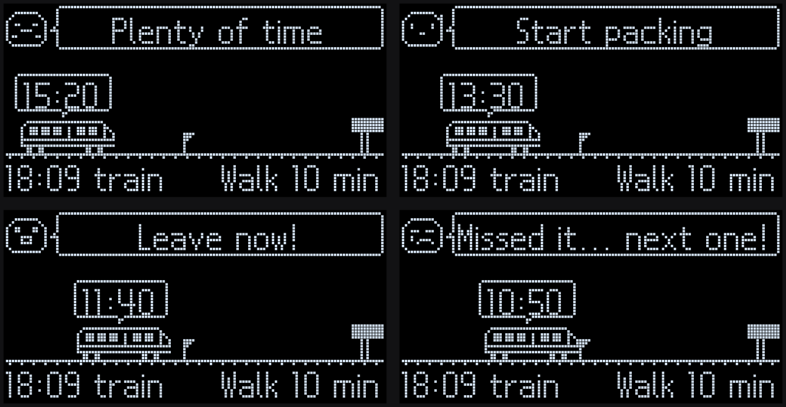
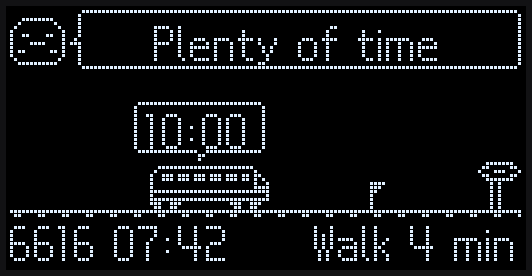
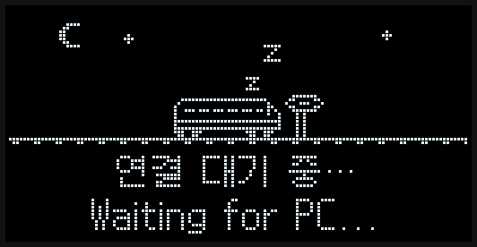

# NU40 버스 출발 알림 보드

**경기도 버스가 정류장에 오기 전에 "지금 나가세요"를 알려 주는 책상 위 OLED 보드**

> **원작:** 이 프로젝트는 [haeun2525/nu40-commute](https://github.com/haeun2525/nu40-commute)(NU40 DK 퇴근 알림 보드, 서울 지하철용)를
> 바탕으로 **경기도 버스용으로 바꾼 것**입니다. 보드 펌웨어 구조, 화면 디자인, 캐릭터·말풍선 그림, 글꼴 생성 방식은 원작에서 왔습니다.
> 지하철·시간표 기능은 지우고 경기도 버스 실시간 도착정보로 탈 버스를 고르도록 다시 만들었습니다.



| 다가오는 버스 | 잠자는 화면 |
|:---:|:---:|
|  |  |

*A desk board for Gyeonggi-do (Korea) bus riders. A Python script picks the bus you can still catch from the
data.go.kr live arrival API, and an NU40 DK + SSD1306 OLED shows a pixel bus rolling to the stop.
Screens are English (`LANG=en`) or Korean (`LANG=ko`).*

---

## 목차

1. [소개](#1-소개)
2. [빠른 시작: 세 가지만 넣으면 됩니다](#2-빠른-시작-세-가지만-넣으면-됩니다)
3. [LLM에 붙여 넣어 설정하기](#3-llm에-붙여-넣어-설정하기)
4. [준비물과 배선](#4-준비물과-배선)
5. [설치와 펌웨어 굽기](#5-설치와-펌웨어-굽기)
6. [설정 항목](#6-설정-항목)
7. [실행과 옵션](#7-실행과-옵션)
8. [자주 나는 문제](#8-자주-나는-문제)
9. [동작 원리](#9-동작-원리)
10. [개발자용 참고](#10-개발자용-참고)
11. [보안과 출처](#11-보안과-출처)

---

## 1. 소개

PC의 파이썬 프로그램이 경기도 버스 도착정보를 받아 **지금 나가서 탈 수 있는 버스**를 고릅니다.
책상 위의 **NU40 DK(nRF52840) + 0.96" SSD1306 OLED**는 정류장으로 다가오는 픽셀 버스와 함께 언제 나가야 하는지 보여 줍니다.

**동작 순서:** 공공데이터포털(버스 도착정보) → PC 프로그램이 탈 버스를 고름 → USB로 보드에 보냄 → OLED에 그림

### 화면 상태

나갈 때까지 남은 시간 = 버스 도착까지 남은 시간 − (걷는 시간 + 여유). 기본값은 걷는 시간 4분, 여유 1분입니다.

| 상태 | 언제 | 영어 화면 | 한글 화면 |
|---|---|---|---|
| 여유 | 나갈 때까지 3분 넘게 남음 | `Plenty of time` | `아직 여유 있어요` |
| 짐 싸기 | 나갈 때까지 3분 이하 | `Start packing` | `슬슬 짐 싸야 해요` |
| 출발 | 나갈 때까지 1분 이하 (여유분을 다 써도 걸어서 닿는 동안) | `Leave now!` | `지금 출발해야 해요!` |
| 뛰면 가능 | 버스 도착까지 걷는 시간보다 적게, 그 80% 이상 남음 | `Run, you'll make it!` | `지금 뛰면 가능해요!` |
| 놓침 | 버스 도착까지 걷는 시간의 80%보다 적게 남음 | `Missed it... next one!` | `놓쳤어요… 다음 거!` |

- **출발·뛰면 가능:** 캐릭터가 깡총거리고 글자가 깜빡이며 LED1이 켜집니다.
- **놓침:** 5초 보여 준 뒤 다음 버스로 넘어갑니다.
- **버스 위치:** 16분 전에 왼쪽 끝에서 출발해 도착 시각에 오른쪽 정류장에 닿습니다. 깃발은 나가야 하는 시점입니다.
- **잠자는 화면:** PC 프로그램이 멈추거나 30초 넘게 아무것도 보내지 않으면 잠자는 버스 화면으로 바뀝니다.

---

## 2. 빠른 시작: 세 가지만 넣으면 됩니다

넣을 것은 **공공데이터포털 인증키**, **정류장 번호**, **타는 버스 번호** 세 가지입니다.

- **필요한 것:** 보드(NU40 DK + SSD1306 OLED, [배선](#4-준비물과-배선)), 파이썬 3.9 이상이 깔린 PC
- **LLM에게 맡기려면:** [3. LLM에 붙여 넣어 설정하기](#3-llm에-붙여-넣어-설정하기)를 쓰세요.

> [!NOTE]
> 이 보드는 **경기도 버스 도착정보**만 씁니다. 경기도 버스가 서는 정류장이어야 합니다.

### 1단계. 공공데이터포털 인증키 받기

1. [공공데이터포털(data.go.kr)](https://www.data.go.kr)에 회원가입하고 로그인합니다. 가입할 때 본인 인증이 있습니다.
2. 검색창에 `경기도_버스도착정보 조회`를 검색합니다. 오픈 API 결과에서 그 항목을 열고 **활용신청**을 누릅니다.
   - 활용 목적은 "개인 프로젝트: 버스 도착 알림 보드" 정도로 쓰면 됩니다.
   - 개발계정은 보통 바로 승인됩니다.
3. 같은 방법으로 `경기도_정류소 조회`도 **활용신청**합니다. 정류장 번호를 정류소 ID로 바꾸는 데 씁니다.
4. **마이페이지 → 데이터활용 → Open API → 활용신청 현황**에서 신청한 API를 누르면 **일반 인증키**가 보입니다.
   - Encoding 키와 Decoding 키 중 아무거나 복사합니다.
   - 키는 계정마다 하나입니다. 두 API에 같은 키를 씁니다.
   - 메뉴 이름은 사이트 개편으로 조금 다를 수 있습니다.
5. 승인 직후에는 키가 바로 동작하지 않을 수 있습니다. 오류가 나면 잠시 뒤 다시 해 보세요.

### 2단계. 정류장 번호와 버스 번호 확인

카카오맵이나 카카오버스 앱을 씁니다.

1. 버스를 **타는** 정류장을 검색해 누릅니다.
2. 정류장 이름 아래(또는 옆)의 **5자리 번호**가 정류장 번호입니다. 예: `14320` (`14-320`처럼 보여도 됩니다)
3. 같은 화면의 노선 목록에서 **타는 버스 번호**를 적어 둡니다. 예: `6616`, `6638`

> [!TIP]
> 길 건너편 정류장은 번호가 다릅니다. 타는 쪽 정류장인지 확인하세요.

### 3단계. 설치하고 세 줄 넣기

**① 내려받고 설치합니다.**

```bash
git clone https://github.com/tunatuna1002-lab/nu40-commute.git
cd nu40-commute
python3 -m venv .venv
.venv/bin/pip install -r host/requirements.txt
cp host/config.example.env host/.env
```

**② `host/.env`를 메모장 같은 편집기로 열고 맨 위 세 줄을 채웁니다.**

```
BUS_API_KEY=여기에_인증키
BUS_STOP_NO=14320
BUS_ROUTES=6616,6638
```

- 걷는 시간이 4분이 아니면 `WALK_MINUTES`를 바꿉니다.
- 알림 받을 시간대가 06:30~09:30이 아니면 `ON_AT`, `OFF_AT`을 바꿉니다.

**③ 보드에 펌웨어를 굽고([5. 설치와 펌웨어 굽기](#5-설치와-펌웨어-굽기)) 실행합니다.**

```bash
.venv/bin/python host/commute.py --dry-run --always-on   # 보드 없이 확인
.venv/bin/python host/commute.py                         # 보드에 표시
```

로그에 `Stop number 14320 → stationId …`와 `Bus arrivals: …`가 보이면 키와 정류장이 맞게 들어간 것입니다.

> [!WARNING]
> `host/.env`는 깃에 올라가지 않습니다. 인증키를 남에게 보여 주지 마세요.

---

## 3. LLM에 붙여 넣어 설정하기

아래 프롬프트를 통째로 복사해 ChatGPT, Claude, Gemini 같은 LLM에 붙여 넣으세요.

- LLM이 정류장 번호, 버스 번호, 인증키가 있는지를 차례로 물어보며 안내합니다.
- Claude Code처럼 내 컴퓨터에서 명령을 실행할 수 있는 도구라면 설치와 설정까지 직접 합니다.
- 인증키는 채팅창에 붙여 넣지 않고 `host/.env`에 직접 넣도록 안내합니다.

<details>
<summary><b>프롬프트 펼치기</b> (펼친 뒤 상자 오른쪽 위의 복사 버튼)</summary>

```text
너는 "NU40 DK 버스 출발 알림 보드"를 처음 설치하는 사람을 돕는 도우미야.
저장소: https://github.com/tunatuna1002-lab/nu40-commute
README.md와 host/config.example.env를 읽을 수 있으면 먼저 읽어.

목표: 사용자의 PC에서 host/commute.py가 돌고,
보드 OLED에 사용자가 타는 버스의 출발 알림이 뜨게 한다.

진행 규칙
- 한 번에 한 가지만 묻고, 답을 받은 뒤 다음으로 넘어가.
- 사용자는 초보자일 수 있다. 짧게, 번호를 붙여 설명해.
- 내 컴퓨터에서 명령을 실행할 수 있으면 직접 하고,
  없으면 실행할 명령을 하나씩 알려 줘.

1. 먼저 물어볼 것
 ① 정류장 번호: 카카오맵이나 카카오버스 앱에서 타는 정류장을
    누르면 이름 아래에 보이는 5자리 번호 (예: 14320, 14-320).
    길 건너편 정류장은 번호가 다르니 타는 쪽인지 확인시켜.
 ② 타는 버스 번호: 그 정류장에서 타는 노선, 여러 개면 쉼표로
    (예: 6616,6638).
 ③ 공공데이터포털 인증키가 있는지 (키 값 자체는 묻지 마).
 선택: 정류장까지 걷는 시간(분, 기본 4),
       알림 시간대(기본 06:30~09:30), 화면 언어(en/ko, 기본 en).

2. 인증키가 없으면 이렇게 안내해
 - https://www.data.go.kr 회원가입과 로그인은 사용자가 직접 한다.
   (본인 인증 포함. 네가 계정을 만들거나 비밀번호를 다루지 마)
 - 검색창에 "경기도_버스도착정보 조회" → 오픈 API 항목 → [활용신청].
   활용 목적: "개인 프로젝트: 버스 도착 알림 보드". 보통 바로 승인.
 - 같은 방법으로 "경기도_정류소 조회"도 [활용신청].
 - 마이페이지 → 데이터활용 → Open API → 활용신청 현황 → 신청한 API
   → "일반 인증키" (Encoding/Decoding 아무거나, 두 API에 같은 키).
 - 승인 직후엔 키가 바로 안 될 수 있다. 잠시 뒤 다시 시도.

3. 인증키 다루기
 - 키를 이 대화창에 붙여 넣지 말라고 안내해.
 - 사용자가 host/.env의 BUS_API_KEY= 뒤에 직접 붙여 넣게 해.
 - 네가 파일을 쓸 수 있으면 키 자리만 비운 .env를 만들어 둬.
 - 키 값을 화면에 출력하거나 다시 말하지 마.

4. 설치 (macOS·Linux. Windows는 .venv\Scripts\python으로)
   git clone https://github.com/tunatuna1002-lab/nu40-commute.git
   cd nu40-commute
   python3 -m venv .venv
   .venv/bin/pip install -r host/requirements.txt
   cp host/config.example.env host/.env
 - host/.env에 BUS_STOP_NO, BUS_ROUTES를 답대로 채우고,
   WALK_MINUTES, ON_AT, OFF_AT, LANG도 답에 맞게 바꾼다.

5. 보드
 - NU40 DK에 SSD1306 OLED 연결: SDA=P0.26, SCL=P0.27,
   VCC=3V3 (5V 금지), GND=GND.
 - 가장 쉬운 굽기: 보드 RESET을 두 번 눌러 NRF52BOOT 드라이브가
   뜨면 build/nu40_commute/nu40_commute.uf2를 거기에 복사.
 - 잠자는 버스 화면과 "Waiting for PC..."가 보이면 성공.

6. 확인
   .venv/bin/python host/commute.py --demo --dry-run
     (키 없이 프로그램 확인)
   .venv/bin/python host/commute.py --dry-run --always-on
     (로그에 "Stop number ... → stationId ..."와
      "Bus arrivals: ..."가 보이면 키·정류장 OK)
   .venv/bin/python host/commute.py --always-on
     (보드에 바로 표시)
   평소: .venv/bin/python host/commute.py (ON_AT~OFF_AT에만 켜짐)

7. 자주 나는 문제 (로그를 보고 판단해)
 - "not JSON" / "JSON이 아닙니다": 활용신청이 안 됐거나 키 활성화 전.
 - "Stop number ... was not found": 번호 오타이거나
   경기도 버스가 서지 않는 정류장.
 - "No bus to catch": 지금 걸어서 탈 수 있는 버스가 없음 (정상일 수 있음).
 - "No board found": USB 케이블(데이터용인지), --port로 포트 지정.
 - 그 밖에는 README의 "자주 나는 문제" 표를 봐.
```

</details>

---

## 4. 준비물과 배선

| 부품 | 내용 |
|---|---|
| 보드 | NUCODE NU40 DK (NU40-B-Dev02), Nordic nRF52840, USB-C |
| 화면 | SSD1306 128×64 OLED, I2C, 주소 `0x3C` (안 잡히면 `0x3D` 자동 시도) |
| 케이블 | 데이터 전송이 되는 USB-C 케이블 |

**OLED 연결**

| OLED 핀 | 보드 핀 | USER TERMINAL 번호 |
|---|---|---|
| SDA | **P0.26** | 25번 |
| SCL | **P0.27** | 26번 |
| VCC | **3V3** (5V에 꽂지 마세요) | 27번 |
| GND | **GND** | 24번 |

보드의 버튼(S1~S4)과 LED(LED1~4)는 보드에 달려 있어 따로 연결하지 않습니다.

**버튼과 LED**

| 이름 | 하는 일 |
|---|---|
| **S1** | 꺼져 있으면 10초 뒤 켜짐(LED4가 한 번 깜빡), 켜져 있으면 바로 꺼짐, 10초 카운트 중 다시 누르면 취소 |
| **S2** | 데모 ↔ 실시간 전환 |
| S3, S4 | 예비 |
| LED1 | 출발·뛰면 가능 상태 |
| LED2 | 데모 모드 |

---

## 5. 설치와 펌웨어 굽기

### 파이썬 (PC 프로그램)

```bash
cd nu40-commute
python3 -m venv .venv
.venv/bin/pip install -r host/requirements.txt      # requests, pyserial, Pillow
```

### 펌웨어 (보드)

방법 세 가지 중 하나를 고릅니다. 처음이면 **방법 A**가 가장 쉽습니다.

| 방법 | 순서 |
|---|---|
| **A. 파일 복사** (프로그램 불필요) | 보드의 RESET을 두 번 누름 → `NRF52BOOT` 드라이브가 뜸 → `build/nu40_commute/nu40_commute.uf2`를 그 드라이브에 복사 |
| B. 아두이노 IDE 2.x | 보드 매니저에서 **NUBoards nRF52 by NUCODE** 설치 → **NU40DK nRF52840** 선택 → 라이브러리 관리에서 **Adafruit SSD1306** 설치(Install all) → `firmware/nu40_commute/nu40_commute.ino`를 폴더째로 열고 업로드 |
| C. arduino-cli | `arduino-cli compile --fqbn nucode:nrf52:nu40dk firmware/nu40_commute` 뒤 `arduino-cli upload -p /dev/cu.usbmodem1101 --fqbn nucode:nrf52:nu40dk firmware/nu40_commute` |

잠자는 버스 아래에 `연결 대기 중… / Waiting for PC...`가 뜨면 성공입니다.

---

## 6. 설정 항목

설정은 `host/.env`에 씁니다. 처음에는 `cp host/config.example.env host/.env`로 만듭니다.

**꼭 채울 것**

| 항목 | 예 | 뜻 |
|---|---|---|
| `BUS_API_KEY` | — | 공공데이터포털 일반 인증키 (`경기도_버스도착정보 조회`, `경기도_정류소 조회` 활용신청) |
| `BUS_STOP_NO` | `14320` | 카카오맵·카카오버스의 5자리 정류장 번호. 시작할 때 정류소 ID로 바꿉니다 |
| `BUS_ROUTES` | `6616,6638` | 타는 버스 번호, 쉼표로 구분. 비우면 그 정류장의 모든 노선 |

**필요하면 바꿀 것**

| 항목 | 기본값 | 뜻 |
|---|---|---|
| `WALK_MINUTES` | `4` | 정류장까지 걷는 시간(분) |
| `BUFFER_MINUTES` | `1` | 여유(분) |
| `ON_AT` / `OFF_AT` | `06:30` / `09:30` | 화면이 켜지는 시간대. 이 밖에서는 화면을 끄고 API도 부르지 않습니다. 둘 다 비우면 항상 켭니다 |
| `OFF_AT_ONCE` | 비움 | 하루만 늦게 끄기. 예: `2026-10-29 18:00` (그날만 `OFF_AT` 대신) |
| `DINO_UNTIL` | 비움 | 예: `13:00`. 버스 시간대가 끝난 뒤 이때까지 작은 공룡이 왔다 갔다 합니다 |
| `BED_AT` / `BED_OFF_AT` | 비움 / `00:00` | 예: `22:00`. 토끼가 자라고 하고, `BED_OFF_AT`에 "Me too. Good night!" 하고 1분 뒤 화면을 끕니다 |
| `IDLE_SCENE` | 비움 | `gohard`로 두면 버스·공룡·토끼 시간이 아닐 때 토끼가 "Go hard!" 합니다. 비우면 그 시간엔 화면을 끕니다 |
| `LANG` | `en` | 화면·로그 언어 (`en` / `ko`) |
| `SERIAL_PORT` | 자동 | 보드 포트. 예: `/dev/cu.usbmodem1101`, `COM3` |
| `BUS_POLL_SECONDS` | `60` | 도착정보 호출 간격(초, 최소 30) |
| `BUS_DAILY_LIMIT` | `1000` | 하루 호출 한도 (`0` = 제한 없음) |
| `BUS_STATION_ID` | — | 9자리 정류소 ID를 직접 넣을 때. 넣으면 `BUS_STOP_NO`로 찾지 않습니다 |
| `DEMO_SPEED` | `8` | 데모 배속 |

> [!TIP]
> 같은 정류장 번호가 여러 곳이면 첫 번째를 쓰고 로그에 목록을 보여 줍니다. 다른 곳이면 그 ID를 `BUS_STATION_ID`에 넣으세요.

---

## 7. 실행과 옵션

```bash
.venv/bin/python host/commute.py --demo --dry-run   # 보드·키 없이: 보낼 줄을 터미널에 찍기
.venv/bin/python host/commute.py --demo             # 보드에서 데모 (가짜 버스)
.venv/bin/python host/commute.py                    # 실시간. ON_AT에 켜지고 OFF_AT에 꺼짐
.venv/bin/python host/commute.py --always-on        # 시간대 무시하고 지금 바로
```

`Ctrl+C`로 멈춥니다. 멈추면 보드는 잠자는 화면으로 바뀝니다.

| 옵션 | 뜻 |
|---|---|
| `--demo` | 가짜 시계(오늘 07:26부터 8배속)와 가짜 버스(07:42부터 3분 30초 간격, 6616·6638 번갈아) |
| `--demo-speed N` | 데모 배속 |
| `--lang en\|ko` | 화면 언어 (`.env`의 `LANG`보다 우선) |
| `--dry-run` | 보드 없이 보낼 줄을 `>>`로 출력 (터미널에 `BTN\|2`를 치면 버튼 흉내) |
| `--port` | 시리얼 포트 직접 지정 |
| `--always-on` | `ON_AT`/`OFF_AT` 무시 |
| `--start-after N` | 시작 후 N초 동안 화면을 꺼 뒀다가 켬 (촬영용) |
| `--render PNG` | 보낸 장면을 PNG로 저장 (Pillow와 갈무리9 글꼴 필요) |
| `--duration SEC` | SEC초 뒤 종료 (테스트용) |
| `--verbose` | 보내는 줄 전부 출력 |

**켜짐과 꺼짐**

1. `ON_AT`~`OFF_AT` 안에서만 버스를 보입니다. 밖에서는 `Off hours`를 보낸 뒤 화면을 끕니다.
   `DINO_UNTIL`이나 `BED_AT`을 넣으면 그 시간에는 공룡이나 토끼 장면을 보입니다. `IDLE_SCENE=gohard`면 나머지 시간에 "Go hard!" 장면을 보입니다. 장면은 API를 부르지 않습니다.
2. S1로 정한 켜짐·꺼짐은 다음 S1까지 PC가 덮어쓰지 않습니다.
3. 데모 모드는 시간대와 관계없이 항상 켭니다.
4. PC가 갑자기 꺼지거나 케이블이 빠져도 보드는 30초 뒤 스스로 잠자는 화면으로 바뀝니다.

**맥에서 자동으로 켜기**

PC 프로그램이 돌아야 보드에 버스가 나옵니다. 매일 아침 직접 켜기 싫으면 로그인할 때 혼자 켜지게 하세요.

```bash
host/autostart_mac.sh install     # 지금 시작하고, 로그인할 때마다 시작
host/autostart_mac.sh status      # 돌고 있는지와 최근 기록
host/autostart_mac.sh uninstall   # 자동 시작 끄기
```

1. 기록은 `~/Library/Logs/nu40-commute.log`에 쌓입니다.
2. 프로그램이 끝나면(보드가 안 꽂혀 있을 때 등) 30초 뒤 다시 켜집니다.
3. 저장소가 `문서`·`데스크탑`·`다운로드` 폴더 안에 있으면 처음에 맥이 "Python이 폴더에 접근하려고 합니다"라고 묻습니다. **허용**을 누르세요. 창을 놓쳤으면 `시스템 설정 → 개인정보 보호 및 보안 → 파일 및 폴더`에서 Python을 켭니다.
4. 자동 시작 중에는 터미널에서 따로 `commute.py`를 켜지 마세요. 두 프로그램이 같은 포트를 두고 다툽니다. 먼저 `uninstall` 하세요.

---

## 8. 자주 나는 문제

| 증상 | 확인할 것 |
|---|---|
| 화면이 안 켜짐 | SDA/SCL을 바꿔 꽂아 보기, VCC가 3V3인지, 점퍼선 교체. 시리얼 모니터에 `ERR\|No OLED`가 반복되면 배선 문제 |
| 잠자는 화면에서 안 바뀜 | PC 프로그램이 안 돌거나 포트가 다름. 아두이노 시리얼 모니터를 닫았는지 확인. 자동 시작이면 `host/autostart_mac.sh status`로 기록 확인 |
| 화면이 꺼져 있음 | `ON_AT`~`OFF_AT` 밖이면 정상. S1을 누르거나 `--always-on` |
| `No bus to catch` | 걸어서 탈 수 있는 버스가 없음 (너무 가까이 왔거나, 늦은 밤이라 운행이 없음) |
| `... response is not JSON` | 그 API의 활용신청이 안 됐거나, 키가 아직 활성화 전이거나, 하루 한도 초과 |
| `Stop number … was not found` | 정류장 번호 오타, 또는 경기도 버스가 서지 않는 정류장 |
| `The bus response has no result header` | 정류소 ID가 틀림. `BUS_STATION_ID`를 비우고 `BUS_STOP_NO`로 다시 |
| `No board found` | 데이터용 USB 케이블인지 확인, `--port`로 포트 지정 |
| 아래 줄 노선 이름에 빈칸 | 노선 이름의 한글이 보드 글꼴에 없음 (로그에 경고). [글꼴](#글꼴) 참고 |
| 아래 줄이나 깃발이 이상함 | 펌웨어가 예전 버전. 다시 굽기 |
| 업로드 실패 `No data received` | RESET 두 번 → 부트로더 드라이브 → 다시 업로드하거나 UF2 복사 |

---

## 9. 동작 원리

### 탈 버스 고르기

경기도 버스도착정보 API는 시간표가 없습니다. 정류장의 노선마다 **다음 2대**만 알려 주고 배차도 깁니다.
그래서 프로그램은 이렇게 동작합니다.

- **고르기:** 걸어서 닿을 수 있는 버스(걷는 시간 이상 남은 버스)면 고릅니다. 여유분이 모자라면 처음부터 출발이나 뛰면 가능 상태로 나옵니다.
- **노선:** `BUS_ROUTES` 중 먼저 오는 탈 수 있는 버스를 보여 줍니다. 따라가던 버스보다 90초 넘게 먼저 오는 버스가 보이면 그 버스로 바꿉니다.
- **놓침:** 나가야 할 때 따라가던 버스가 목록에서 빠지면(정류장을 지나감) 5초 동안 놓침을 보여 주고 다음 버스로 넘어갑니다.

### 흔들리는 예측 다듬기

예측은 분 단위라 호출마다 튑니다.

- 같은 차량이면 30초 안쪽 변화는 무시합니다.
- 한 번 호출에 늦어지는 쪽은 +30초, 빨라지는 쪽은 −120초까지만 따라갑니다.
- 다듬은 값은 이번 예측에서 60초(초 단위 예측이면 30초) 넘게 벗어나지 않습니다.
- 덜 급한 상태로 돌아갈 때는 60초 여유가 더 생겨야 돌아갑니다. 그래서 화면이 왔다 갔다 하지 않습니다.

### API 호출

- 고른 노선이 응답에서 통째로 한 번 빠지면 일시적인 것으로 보고 이전 목록을 씁니다. 두 번 연속이면 비웁니다.
- 호출이 실패하면 간격을 60초 → 120초 → 240초 … 최대 10분까지 늘립니다.
- `BUS_DAILY_LIMIT`(기본 1000)에 닿으면 그날은 더 부르지 않습니다.
- 예측은 응답을 받은 때 기준으로 붙입니다. PC 시계가 서버 시각(`queryTime`)과 2분 넘게 다르면 한 번 알려 줍니다.

---

## 10. 개발자용 참고

### 화면 배치 (128×64)

```
┌────────────────────────────┐
│(얼굴)< Leave now!          │  y 0~14  캐릭터 + 말풍선
│      ┌5:40┐                │  y 23~35 남은 시간
│      ▄▄▄▄▄▄▄▄  ▌     ▐ ○ ▌ │  y 39~49 버스, 깃발, 정류장
│━━━━━━━━━━━━━━━━━━━━━━━━━━━━│  y 50~51 도로, 점선 차선
│6616 07:42        Walk 4 min│  y 52    노선·도착 시각 / 걷는 시간
└────────────────────────────┘
```

- 버스 앞코 x = `116 − round(남은 초 / 960 × 82)`. 16분 전 x=34에서 출발해 도착 때 정류장(x=116)에 닿습니다.
- 깃발은 출발선(PC가 보내는 `leave_s` = 걷는 시간 + 여유) 자리에 그립니다.
- 보드는 받은 남은 시간을 혼자 1초씩 깎으며 그립니다. PC가 5초에 한 번만 보내도 매끄럽게 움직입니다.
- 화면 디자인의 기준은 `tools/preview/preview.py`입니다. 펌웨어 `drawScreen()`은 그 `render()`를 좌표·순서 그대로 옮겼습니다. 디자인을 고칠 때는 두 파일을 같이 고치세요.

```bash
.venv/bin/python tools/preview/preview.py                # 시안 PNG + GIF (한글·영어)
.venv/bin/python tools/preview/preview.py --check-font   # 펌웨어 글꼴이 시안과 같은지 검사
.venv/bin/python tools/preview/preview.py --line "S|go|700|1|300|6616 07:42|Walk 4 min|Leave now!" --out x.png
```

### 글꼴

- [갈무리9(Galmuri9)](https://github.com/quiple/galmuri) 픽셀 글꼴(SIL OFL 1.1)을 비트맵으로 떠서 `commute_font.h`에 넣었습니다.
- 화면에 나오는 한글과 출력 가능한 ASCII 전부, 140자입니다.
- 영어 문구는 다 들어 있습니다. `host/commute.py`의 `MESSAGES["en"]`만 고치면 됩니다(말풍선 폭 111픽셀 안).
- 한글 문구를 바꾸면 글꼴을 다시 만들고 펌웨어를 다시 구워야 합니다. `host/commute.py`는 시작할 때 없는 글자를 경고합니다.

```bash
# Galmuri v2.40.3 릴리스 zip의 Galmuri9Bitmap-Regular-2.40.3.ttf를 ~/Library/Fonts/에 넣은 뒤
.venv/bin/python tools/make_commute_font.py              # → firmware/nu40_commute/commute_font.h
```

### 시리얼 규약 (115200, 줄 단위, UTF-8)

**PC → 보드**

| 줄 | 뜻 |
|---|---|
| `S\|state\|arrive_s\|speed\|leave_s\|bottom_left\|bottom_right\|msg` | 화면 상태. 아래 표 참고 |
| `N\|text` | 안내 화면. `No bus to catch`, `Error, retrying...`, `Off hours` (한글: `탈 버스 없음`, `오류… 다시 시도 중`, `알림 시간 아님`) |
| `Z\|text` | 잠자는 화면 + 글자 한 줄. PC가 멈출 때 보냅니다 |
| `P\|on` / `P\|off` | 화면 켜기 / 끄기 |
| `M\|demo` / `M\|live` | 모드 표시 (LED2) |

| `S` 줄의 칸 | 뜻 |
|---|---|
| `state` | `relax` / `pack` / `go` / `missed` (뛰면 가능은 `go`로 보냄) |
| `arrive_s` | 도착까지 남은 초 |
| `speed` | 보드가 초를 깎는 배속 (실시간 1, 데모 8) |
| `leave_s` | 출발선(초). 깃발 자리 |
| `bottom_left` / `bottom_right` | 아래 줄 왼쪽·오른쪽 글자. 예: `6616 07:42`, `Walk 4 min` |
| `msg` | 말풍선 문구 |

예: `S|go|700|1|300|6616 07:42|Walk 4 min|Leave now!`
PC는 상태나 문구가 바뀌면 바로, 아니면 5초(데모 2초)마다 다시 보냅니다.
보드는 PC가 30초 넘게 아무것도 보내지 않으면 잠자는 화면으로 바꿉니다. 켜진 직후에도 잠자는 화면(한글/영어 두 줄)입니다.

**보드 → PC**

| 줄 | 뜻 |
|---|---|
| `READY` | 부팅 완료. PC는 전원·모드·현재 장면을 다시 보냅니다 |
| `BTN\|n` | 버튼 n(1~4) 눌림 |
| `PWR\|arming` / `PWR\|cancel` | S1로 10초 카운트 시작 / 취소 |
| `PWR\|on` / `PWR\|off` | 10초 뒤 화면이 켜짐 / S1로 끔 |
| `ERR\|메시지` | 보드 쪽 오류 (OLED를 못 찾음, 칸이 모자란 S 줄 등) |

### 파일 구성

| 파일 | 내용 |
|---|---|
| `host/commute.py` | PC 프로그램: 버스 도착정보 → 탈 버스 → 상태 → 시리얼 |
| `host/config.example.env` | 설정 템플릿 (`host/.env`로 복사) |
| `host/requirements.txt` | 파이썬 라이브러리 |
| `host/autostart_mac.sh` | 맥 로그인 때 자동 시작 (launchd) |
| `firmware/nu40_commute/nu40_commute.ino` | 보드 펌웨어 (그리기, 카운트다운, 버튼, LED) |
| `firmware/nu40_commute/commute_font.h` | 글꼴 데이터 (자동 생성물, 고치지 말 것) |
| `build/nu40_commute/nu40_commute.uf2` | 컴파일된 펌웨어 (복사해서 굽기) |
| `tools/preview/preview.py` | 화면 시안 = 디자인 기준 |
| `tools/preview/*.png`, `*.gif` | 시안 이미지 (`en_*`는 영어, 나머지는 한글, `0_boot.png`·`sleep.gif`는 잠자는 화면) |
| `tools/make_commute_font.py` | 글꼴 헤더 생성기 |

---

## 11. 보안과 출처

**보안**

- `host/.env`는 `.gitignore`에 있어 깃에 올라가지 않습니다.
- 인증키는 로그에 찍지 않습니다. 오류 메시지에 키가 섞여 있으면 `****`로 가립니다.
- 프로그램이 부르는 API는 경기도 버스도착정보 조회 하나입니다. `BUS_STOP_NO`를 쓰면 시작할 때 한 번 경기도 정류소 조회도 부릅니다.

**출처**

- 원작: [haeun2525/nu40-commute](https://github.com/haeun2525/nu40-commute) (NU40 DK 퇴근 알림 보드)
- 글꼴: [갈무리(Galmuri)](https://github.com/quiple/galmuri) by quiple, SIL Open Font License 1.1
- 데이터: [공공데이터포털](https://www.data.go.kr) 경기도 버스도착정보·정류소 조회
