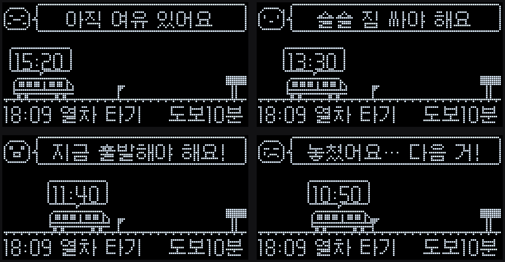

# NU40 DK + OLED 퇴근 알림 보드

서울시 지하철 API 로 **삼성역(2호선, 잠실 방면)** 열차 시각을 받아,
"회사에서 **지금 나가면 탈 수 있는 열차**"를 골라 USB 로 연결된 **NU40 DK 보드의 0.96인치 OLED** 에 띄웁니다.
열차가 레일 위를 달려 역으로 다가오고, 깃발(출발선)을 지나기 전에 캐릭터가 알려 줍니다.

```
서울시 지하철 API ──REST──▶ PC(파이썬 host/commute.py) ──USB 시리얼──▶ NU40 DK ──I2C──▶ OLED
 (시간표 + 실시간)            탈 열차 고르기 · 상태 판단                    그리기 · 애니메이션 · 버튼
```

| 상태 | 조건 (나갈 때까지 남은 시간) | 화면 |
|---|---|---|
| 여유 | 3분 넘게 남음 | `아직 여유 있어요` |
| 짐 싸기 | 3분 이하 | `슬슬 짐 싸야 해요` |
| 출발 | 1분 이하 | `지금 출발해야 해요!` (캐릭터가 깡총, 글자 깜빡, LED1 켜짐) |
| 놓침 | 지남 | `놓쳤어요… 다음 거!` 5초 → 다음 열차로 |

**나갈 시각 = 열차 도착 − 도보 10분 − 여유 1분.**
환승이 있어도 나갈 시각은 삼성역 열차만 보면 되므로 삼성역만 조회합니다.



### 왜 이렇게 나눴나

NU40 은 nRF52840 칩이라 **WiFi 가 없습니다.** 그래서 인터넷 호출·시간표 해석·"지금 나가야 하나" 판단은 전부
PC(파이썬)가 하고, 보드는 **받은 상태를 그리고 남은 시간을 혼자 깎으며 열차를 움직이기만** 합니다.
구조·배선·시리얼 설정은 `~/nu40-stock-ticker` 와 같습니다.

### 왜 시간표가 주인공이고 실시간은 보조인가

실시간 도착정보는 방면마다 **다음 2대(약 4분 앞)** 까지만 옵니다. 그런데 도보 10분 + 여유 1분 = 11분이라
**실시간에 보이는 열차는 이미 못 탑니다.** 그래서

- **시간표** 에서 "지금 + 11분 이후 첫 열차"를 고르고 (하루 한 번 받아 `host/cache/` 에 저장)
- **실시간** 은 지금 보이는 열차들이 시간표보다 얼마나 늦는지(열차번호로 대조)를 재서 **지연 보정** 에만 씁니다.
  고른 열차 자체가 보이면 그 값을 그대로 씁니다. 실시간은 60초에 한 번만 불러 하루 한도(약 1,000건)를 지킵니다.

---

## 1. 배선표 (주식 티커와 동일)

**보드:** NUCODE NU40 DK (NU40-B-Dev02), Nordic nRF52840, USB-C
**화면:** SSD1306, 128×64, I2C, 주소 `0x3C` (안 잡히면 `0x3D` 자동 시도)

| 항목 | 핀 | USER TERMINAL 번호 |
|---|---|---|
| OLED SDA | **P0.26** | 25번 |
| OLED SCL | **P0.27** | 26번 |
| OLED VCC | **3V3** (3.3V OUT) | 27번 |
| OLED GND | **GND** | 24번 |
| 버튼 S1~S4 (보드 내장) | P0.11 / P0.12 / P0.24 / P0.25 | — |
| LED 1~4 (보드 내장) | P0.13 / P0.14 / P0.15 / P0.16 | — |

NU40DK 보드 패키지의 variant.h 에 `PIN_WIRE_SDA=26, PIN_WIRE_SCL=27` 이 박혀 있어
펌웨어는 `Wire.begin()` 만 부릅니다. (5V 에 꽂으면 안 됩니다)

### 버튼과 LED

| 버튼 | 하는 일 |
|---|---|
| **S1** | 꺼져 있으면 **10초 뒤에 켜짐**(누르면 LED4가 한 번 깜빡), 켜져 있으면 바로 꺼짐, 10초 카운트 중 다시 누르면 취소. 데모 모드에선 켜지는 순간 '여유'부터 다시 시작 |
| **S2** | 데모 ↔ 실시간 전환 (PC 에 `BTN|2` 를 보내면 PC 가 바꿈) |
| S3, S4 | 예비 (`BTN|3`, `BTN|4` 만 보냄) |

| LED | 뜻 |
|---|---|
| LED1 | "지금 출발해야 해요!" 상태일 때 켜짐 |
| LED2 | 데모 모드일 때 켜짐 |

---

## 2. 설치

### 아두이노 IDE (한 번만)

1. 아두이노 IDE 2.x — https://www.arduino.cc/en/software
2. 보드 패키지: `도구 → 보드 → 보드 매니저` 에서 **`NUBoards nRF52 by NUCODE`** 설치 →
   `도구 → 보드 → NUBoards nRF52 → NU40DK nRF52840` 선택 (FQBN `nucode:nrf52:nu40dk`)
3. 라이브러리: `스케치 → 라이브러리 포함하기 → 라이브러리 관리` 에서 **Adafruit SSD1306** 검색 → 설치 →
   "함께 설치할까요?"에 **전부 설치(Install all)** (`Adafruit GFX Library`, `Adafruit BusIO`)

### 파이썬 (한 번만)

```bash
cd ~/nu40-commute
python3 -m venv .venv
.venv/bin/pip install -r host/requirements.txt
```

---

## 3. 펌웨어 굽기 (사용자가 할 일)

**방법 A — 아두이노 IDE (권장)**

1. `firmware/nu40_commute/nu40_commute.ino` 를 엽니다 (폴더째로. `commute_font.h` 가 같이 열립니다).
2. 보드 `NU40DK nRF52840`, 포트 `/dev/cu.usbmodem…` 선택 → **업로드**.
3. 화면에 `연결 대기 중…` 이 뜨면 성공입니다. 아직 PC 가 아무것도 안 보낸 상태입니다.

**방법 B — UF2 드래그 (IDE 없이)**

1. 보드의 **RESET 을 빠르게 두 번** 누르면 `NRF52BOOT` 같은 드라이브가 뜹니다.
2. `build/nu40_commute/nu40_commute.uf2` 를 그 드라이브에 복사합니다.
   (복사 중 `입력/출력 오류` 가 떠도 정상입니다. 다 받자마자 보드가 재시작합니다)

> 업로드가 안 되면 티커 README 의 "업로드가 안 됩니다" 절과 아래 9절을 보세요.
> 맥에서 포트가 안 생기면 `시스템 설정 → 개인정보 보호 및 보안 → 액세서리 연결 허용` 을 먼저 바꾸세요.

---

## 4. 설정

인증키는 프로젝트 루트의 `.env` (`SEOUL_SUBWAY_KEY=…`) 에 이미 들어 있습니다.
나머지 설정을 바꾸려면 `host/.env` 를 만듭니다 (둘 다 읽고, `host/.env` 가 우선):

```bash
cp host/config.example.env host/.env
```

| 항목 | 기본값 | 뜻 |
|---|---|---|
| `SEOUL_SUBWAY_KEY` | — | 서울 열린데이터광장 인증키. 데모만 쓸 땐 없어도 됨 |
| `SERIAL_PORT` | (자동) | `/dev/cu.usbmodem1101`, `COM3` |
| `STATION_NAME` / `STATION_CODE` | `삼성` / `0219` | 실시간 조회 역명 / 시간표 역코드 |
| `UPDN_LINE` / `LINE_HINT` | `외선` / `종합운동장방면` | 방면 고르기 (잠실 방면) |
| `WALK_MINUTES` / `BUFFER_MINUTES` | `10` / `1` | 회사→역 도보, 여유. 출발선 = 도착 − (도보+여유) |
| `ON_AT` / `OFF_AT` | `18:00` / `20:00` | 화면 자동 켜짐·꺼짐 시각. 밖에선 API 도 안 부름. 둘 다 비우면 항상 켬 |
| `REALTIME_POLL_SECONDS` | `60` | 실시간 호출 간격 (최소 30) |
| `HOLIDAYS` | — | 공휴일 추가 (`2026-12-31,…`). 내장 목록은 `host/holidays.py` |
| `DEMO_SPEED` | `8` | 데모 배속 |

요일 처리: 토요일은 토요일 시간표, 일요일·공휴일은 휴일 시간표를 받습니다. 공휴일 목록은
`host/holidays.py` 에 2026년 기준으로 들어 있고 `.env` 의 `HOLIDAYS` 로 더할 수 있습니다.

---

## 5. 실행과 모드

```bash
cd ~/nu40-commute

# 1) 보드 없이 먼저 확인 (보낼 줄을 터미널에 찍는다)
.venv/bin/python host/commute.py --demo --dry-run            # 데모: 키·인터넷 불필요
.venv/bin/python host/commute.py --dry-run --always-on       # 실시간: 실제 API 호출

# 2) 보드에 연결해서
.venv/bin/python host/commute.py --demo                      # 촬영용 데모 (약 45초에 한 바퀴)
.venv/bin/python host/commute.py                             # 실시간. 18:00 에 켜지고 20:00 에 꺼짐
.venv/bin/python host/commute.py --always-on                 # 스케줄 무시하고 지금 바로
.venv/bin/python host/commute.py --demo --start-after 20     # 20초 동안 꺼 뒀다가 켬 (카메라 세팅용)
.venv/bin/python host/commute.py --demo --render shot.png    # 보낼 때마다 보드 화면을 PNG 로
```

`Ctrl+C` 로 멈춥니다. 보드를 꽂지 않고 `--dry-run` 으로 돌리면 터미널에 `BTN|2` 같은 줄을 쳐서
버튼을 흉내 낼 수 있습니다.

| 옵션 | 뜻 |
|---|---|
| `--demo` | 가짜 시계(오늘 17:53 부터 8배속)와 가짜 시간표(18:09 부터 3분 30초 간격). 여유 15초 → 짐 싸기 16초 → 출발 8초 → 놓침 5초 → 다음 열차 |
| `--demo-speed N` | 데모 배속 바꾸기 |
| `--dry-run` | 보드 없이. 시리얼로 보낼 줄을 `>> ` 로 출력 |
| `--port` | 시리얼 포트 직접 지정 |
| `--start-after N` | 시작 후 N초 동안 화면을 꺼 뒀다가 켬 |
| `--always-on` | `ON_AT/OFF_AT` 무시 |
| `--render PNG` | 보낼 때마다 그 장면을 PNG 로 저장 (Pillow + 갈무리9 글꼴 필요) |
| `--duration SEC` | 테스트용. SEC 초 뒤 종료 |
| `--verbose` | 보드 연결 상태에서도 보내는 줄 전부 출력 |

### 켜짐/꺼짐 규칙

1. **스케줄**: `ON_AT ~ OFF_AT` 안에서만 켜고, 밖에서는 `퇴근 시간 아님` 안내를 보낸 뒤 화면을 끕니다 (API 도 안 부름).
2. **S1 버튼**: 꺼져 있으면 10초 뒤 켜짐, 켜져 있으면 바로 꺼짐. S1 로 정한 상태는 PC 가 덮어쓰지 않습니다(다음 S1 까지 유지). 꺼진 시간에 켜 보면 `퇴근 시간 아님` 이 보입니다.
3. **`--start-after N`**: N초 동안 강제로 끔. 그 뒤엔 위 규칙대로.
4. **데모 모드**: 스케줄을 무시하고 항상 켭니다.

정상 로그 예:

```
[18:00:01] 설정 읽음: /Users/.../nu40-commute/.env
[18:00:01] 보드 연결: /dev/cu.usbmodem1101 (115200 baud)
[18:00:01] 모드: 실시간
[18:00:01] 자동 켜짐 18:00 ~ 꺼짐 20:00, 실시간은 60초마다
[18:00:01] 화면 켬
[18:00:02] 시간표 준비: 2026-10-22 평일 240편 (API)
[18:00:02] 실시간: 2347 0:41, 2349 3:21 | 지연 추정 +21초 (열차 2대 대조)
[18:00:02] 탈 열차: 18:13:30(2353) (지연 보정 +21초)
[18:00:02] 실시간 | 탈 열차 18:13:30(2353) | 도착까지 13:49 | 나갈 때까지 2:49 | pack | 지연 +21초
```

---

## 6. 화면 배치 (128×64) — 기준은 `tools/preview/preview.py`

```
┌────────────────────────────┐
│(얼굴)< 지금 출발해야 해요! │  y 0~14  캐릭터(14×12) + 말풍선(x17~127), 글자 y=2
│                            │
│      ┌11:40┐               │  y 23~35 열차 위 말풍선 = 도착까지 남은 시간 (16분 넘으면 16:00+)
│      ▄▄▄▄▄▄▄▄  ▌     ▐▀▀▀▌ │  y 39~49 열차(32×11), 깃발(출발선 x=60), 역 간판·기둥(x117~127)
│━━━━━━━━━━━━━━━━━━━━━━━━━━━━│  y 50    레일, y 51 침목(흐른다)
│18:09 열차 타기     도보10분 │  y 52    맨 아래 줄
└────────────────────────────┘
```

- 열차 앞코 x = `116 − round(남은초 / 960 × 82)`. 16분 전에 x=34 에서 출발해 도착 때 역(116)에 닿습니다.
  깃발은 11분 자리(x=60). 열차가 깃발을 지나면 "놓침"입니다.
- 보드는 PC 가 준 `남은 초` 를 혼자 1초씩 깎으며 그리므로 PC 가 5초에 한 번만 보내도 매끄럽게 움직입니다.
- 200ms 마다 한 프레임: 침목이 1픽셀씩 흐르고, 출발 상태에선 캐릭터가 1픽셀 깡총(매 프레임), 글자가 4프레임 중 1프레임 꺼집니다.

**시안과 보드가 똑같은 이유** — 펌웨어 `drawScreen()` 은 `preview.py` 의 `render()` 를 좌표·순서 그대로 옮겼고,
스프라이트 비트와 `x_at()` 정수식까지 같습니다. 디자인을 고칠 땐 두 파일을 같이 고치세요.

```bash
.venv/bin/python tools/preview/preview.py                    # 시안 4장 + all.png + demo.gif 다시 만들기
.venv/bin/python tools/preview/preview.py --check-font       # 펌웨어 글꼴이 시안 렌더링과 같은지 검사
.venv/bin/python tools/preview/preview.py --line "S|go|700|1|18:09 열차 타기|도보10분|지금 출발해야 해요!" --out x.png
```

### 글꼴

갈무리9(Galmuri9) 픽셀 글꼴. 티커는 한글 2350자를 통째로 넣었지만, 이 보드는 **화면에 나오는 글자만**
(한글 + 숫자 + 기호 67자, 약 1.8KB) 넣습니다. 숫자·기호도 갈무리9라서 시안과 모양이 같습니다.
글자마다 폭이 달라(`1` 은 4픽셀, `4` 는 7픽셀) 폭·위치를 따로 저장합니다.

```bash
.venv/bin/python tools/make_commute_font.py                  # → firmware/nu40_commute/commute_font.h
.venv/bin/python tools/make_commute_font.py --extra "새 글자"
```

문구를 바꾸면 `tools/make_commute_font.py` 의 `TEXTS` 에 넣고 다시 만든 뒤 펌웨어를 다시 구워야 합니다.
`host/commute.py` 는 시작할 때 자기 문구가 헤더에 다 있는지 검사해서 없는 글자를 경고합니다.
(글꼴 파일: `~/Library/Fonts/Galmuri9Bitmap-Regular-2.40.3.ttf`, PIL 크기 12 로 그리면 글자가 y+2 줄부터 찍히는데 그 오프셋까지 그대로 저장)

---

## 7. 시리얼 규약 (115200, 줄 단위, UTF-8)

PC 가 상태와 문구를 정하고, 보드는 그리기만 합니다.

### PC → 보드

| 줄 | 뜻 |
|---|---|
| `S\|<state>\|<arrive_s>\|<speed>\|<bottom_left>\|<bottom_right>\|<msg>` | 화면 상태. `state` = `relax`/`pack`/`go`/`missed`, `arrive_s` = 열차 도착까지 남은 초(음수 가능), `speed` = 보드가 초를 깎는 배속(실시간 1, 데모 8), `bottom_left` = `18:09 열차 타기`, `bottom_right` = `도보10분`, `msg` = 말풍선 문구 |
| `N\|<text>` | 안내 화면 (글자 한 줄 가운데). `연결 대기 중…`, `시간표 받는 중…`, `열차 정보 없음`, `오류… 다시 시도 중`, `퇴근 시간 아님` |
| `P\|on` / `P\|off` | 화면 켜기/끄기 (OLED 자체를 재움. 카운트다운은 계속) |
| `M\|demo` / `M\|live` | 모드 표시 (LED2) |

예: `S|go|700|1|18:09 열차 타기|도보10분|지금 출발해야 해요!`
PC 는 상태·문구가 바뀌면 즉시, 아니면 5초(데모 2초)마다 다시 보냅니다(보드 카운트다운 재동기).

### 보드 → PC

| 줄 | 뜻 |
|---|---|
| `READY` | 부팅 완료. PC 는 전원·모드·현재 장면을 다시 보냅니다 |
| `BTN\|<n>` | 버튼 n(1~4) 눌림 |
| `PWR\|arming` / `PWR\|cancel` | S1 을 눌러 10초 카운트 시작 / 취소 |
| `PWR\|on` / `PWR\|off` | 10초 뒤 화면이 켜졌음 / S1 로 껐음 |
| `ERR\|<메시지>` | 보드 쪽 오류 (OLED 못 찾음 등) |

---

## 8. 데이터 (자세한 조사 기록은 `DATA_SOURCES.md`)

| 무엇 | 주소 | 주기 |
|---|---|---|
| 시간표 | `openapi.seoul.go.kr:8088/{KEY}/json/SearchSTNTimeTableByIDService/1/300/0219/{요일}/2/` (요일 1 평일·2 토·3 휴일, 2 = 외선) | 하루 1번, `host/cache/` 에 저장. 실패하면 예전 캐시 → `samples/` 순으로 대신 씀 |
| 실시간 | `swopenAPI.seoul.go.kr/api/subway/{KEY}/json/realtimeStationArrival/0/10/삼성` → `updnLine=외선`, `trainLineNm` 에 `종합운동장방면` | 60초 (켜진 시간대에만) |

- `barvlDt`(초)가 0 이면 `arvlMsg2`("1분 30초 후", "[2]번째 전역") 를 해석하고, `recptnDt` 로부터 지난 시간만큼 뺍니다.
- 지연 추정 = 보이는 열차마다 (실시간 도착 − 시간표 도착) 의 중앙값. 열차번호(`btrainNo` = `TRAIN_NO`)로 대조하고,
  번호가 없으면 3분 안쪽의 가장 가까운 시간표 열차와 짝짓습니다. −2분 ~ +10분 밖이면 믿지 않습니다.
- 이 역이 종착인 열차(`DESTSTATION=0219`)는 뺍니다. `ARRIVETIME` 이 `24:15:30` 처럼 24시를 넘으면 다음날로 봅니다.
- 인증키는 로그·오류 메시지에 절대 찍지 않습니다 (예외 메시지도 형 이름만 출력).

---

## 9. 자주 나는 문제

| 증상 | 확인 |
|---|---|
| 화면이 안 켜짐 | 티커의 `tools/i2c_scan` 으로 `0x3C` 확인 → SDA/SCL 바꿔 꽂기 → VCC 가 3V3 인지 → 점퍼선 교체. 시리얼 모니터에 `ERR\|No OLED` 가 반복되면 배선 문제 |
| 화면이 `연결 대기 중…` 에서 안 바뀜 | PC 프로그램이 안 돌고 있거나 포트가 다름. `--dry-run` 없이 실행했는지, 아두이노 시리얼 모니터를 닫았는지 확인 |
| 화면이 꺼져 있음 | `ON_AT~OFF_AT` 밖이면 정상. S1 을 누르거나 `--always-on` |
| `보드를 찾지 못했습니다` | 데이터 케이블인지, `ls /dev/cu.usb*`, `--port` 로 직접 지정. 맥은 `액세서리 연결 허용` 설정 |
| `시리얼 포트를 열 수 없습니다` | 아두이노 IDE 시리얼 모니터를 닫으세요 (포트는 한 프로그램만) |
| `실시간 응답 오류: ERROR-3xx` | 키가 틀렸거나 하루 한도 초과. `REALTIME_POLL_SECONDS` 를 늘리세요 |
| 한글 자리가 비어 있음 | 그 글자가 `commute_font.h` 에 없음. 6절 글꼴 참고 (실행 로그에 경고가 뜹니다) |
| 글자 전체가 깨짐 | 속도가 115200 인지 |
| 공휴일인데 평일 시간표 | `host/holidays.py` 나 `.env` 의 `HOLIDAYS` 에 날짜 추가 |
| 업로드 실패 `No data received` | RESET 두 번 → 부트로더 드라이브 → 다시 업로드 또는 UF2 복사 |

---

## 10. 파일 구성

```
firmware/nu40_commute/nu40_commute.ino   보드 펌웨어 (그리기·카운트다운·버튼·LED)
firmware/nu40_commute/commute_font.h      글꼴 데이터 (자동 생성물, 고치지 말 것)
host/commute.py                           PC 프로그램: API → 탈 열차 → 상태 → 시리얼
host/holidays.py                          공휴일 목록·요일 판정
host/config.example.env                   설정 템플릿 (복사해서 host/.env)
host/requirements.txt                     파이썬 라이브러리
host/cache/                               시간표 캐시 (자동 생성)
tools/make_commute_font.py                글꼴 헤더 생성기
tools/preview/preview.py                  화면 시안 = 디자인 기준 (PNG/GIF, --line, --check-font)
tools/preview/*.png, demo.gif             시안 이미지
samples/                                  API 응답 샘플 (키 없이 돌려 볼 때 시간표 대용)
build/nu40_commute/nu40_commute.uf2       컴파일된 펌웨어 (드래그로 굽기)
DATA_SOURCES.md                           데이터 출처 조사 기록
.env                                      SEOUL_SUBWAY_KEY (깃에 안 올라감)
```

## 11. 보안

- `.env` 는 `.gitignore` 에 있어 깃에 올라가지 않습니다.
- 인증키는 어떤 로그에도 찍지 않습니다. 키가 든 URL 도 출력하지 않습니다.
- 이 프로그램은 조회 API 두 개만 부릅니다.
